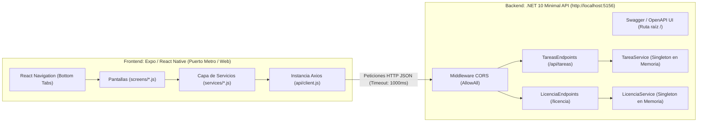
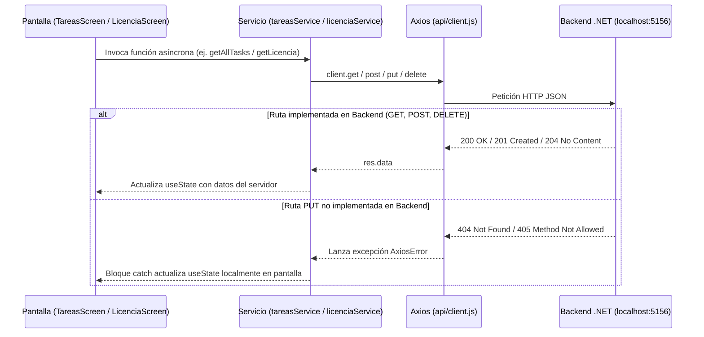

# Entregable Técnico: Infraestructura y Arquitectura Completa del Proyecto

Este documento constituye el entregable técnico integral del proyecto **Tarea-marco** (`my-app-blank` + `TareasAPI`). Contiene el desglose exhaustivo de su infraestructura, stack tecnológico, configuración de red, arquitectura de software, modelos de datos, endpoints de backend, servicios y pantallas de frontend sin omitir ningún detalle.

---

## 1. Arquitectura General del Sistema

El proyecto sigue una arquitectura **Cliente-Servidor monolítica en un mismo repositorio (Monorepo ligero)** compuesta por dos aplicaciones independientes que se comunican mediante HTTP/JSON en entorno local:

1. **Frontend (Cliente Móvil / Web):** Aplicación multiplataforma desarrollada con **React Native** sobre el ecosistema gestionado de **Expo SDK 57**.
2. **Backend (API RESTful):** Servidor web construido en **C# con ASP.NET Core (.NET 10.0) Minimal APIs**, con persistencia de datos **en memoria (In-Memory Singleton)**.



---

## 2. Stack Tecnológico y Versiones Exactas

### 2.1. Frontend ([package.json](file:///c:/Users/gato_/Documents/ISC09C/Tarea-marco/package.json))
| Tecnología / Paquete | Versión Exacta | Rol en la Infraestructura |
| :--- | :--- | :--- |
| **`expo`** | `~57.0.25` | Framework y plataforma base para React Native. |
| **`react`** | `19.2.3` | Biblioteca principal de interfaz de usuario. |
| **`react-dom`** | `19.2.3` | Renderizador DOM para soporte en navegador web. |
| **`react-native`** | `0.86.3` | Framework de componentes nativos móviles. |
| **`react-native-web`** | `^0.21.2` | Compatibilidad de componentes de React Native en Web. |
| **`@react-navigation/native`** | `^7.4.1` | Núcleo del sistema de navegación entre pantallas. |
| **`@react-navigation/bottom-tabs`** | `^7.19.2` | Navegador de barra de pestañas inferior (usado en `App.js`). |
| **`@react-navigation/native-stack`** | `^7.19.2` | Navegador tipo pila (instalado como dependencia, actualmente no instanciado). |
| **`react-native-safe-area-context`** | `~5.7.0` | Manejo de áreas seguras de pantalla (muescas/barras de estado). |
| **`react-native-screens`** | `~4.26.0` | Optimización nativa de vistas para React Navigation. |
| **`@expo/vector-icons`** | `^15.0.2` | Paquete de iconografía (`Ionicons` usado en la barra de navegación). |
| **`expo-status-bar`** | `~57.0.1` | Control de la barra de estado del dispositivo. |
| **`axios`** | `^1.20.0` | Cliente HTTP basado en promesas para consumir la API `.NET`. |

### 2.2. Backend ([TareasAPI.csproj](file:///c:/Users/gato_/Documents/ISC09C/Tarea-marco/TareasAPI/TareasAPI.csproj))
| Tecnología / Paquete | Versión Exacta | Rol en la Infraestructura |
| :--- | :--- | :--- |
| **SDK de Proyecto** | `Microsoft.NET.Sdk.Web` | SDK web de ASP.NET Core. |
| **Target Framework** | `net10.0` | Plataforma de ejecución .NET 10.0 (`Nullable: enable`, `ImplicitUsings: enable`). |
| **`Microsoft.AspNetCore.OpenApi`** | `10.0.12` | Generación de especificaciones OpenAPI nativas de .NET 10. |
| **`Swashbuckle.AspNetCore`** | `10.2.3` | Generador de documentación interactiva Swagger (`SwaggerGen` y `SwaggerUI`). |

---

## 3. Estructura Completa de Directorios y Archivos

```text
c:/Users/gato_/Documents/ISC09C/Tarea-marco/
├── api/
│   └── client.js                           # Cliente Axios configurado hacia http://localhost:5156
├── assets/
│   ├── android-icon-background.png         # Fondo del ícono adaptativo de Android
│   ├── android-icon-foreground.png         # Primer plano del ícono adaptativo de Android
│   ├── android-icon-monochrome.png         # Ícono monocromático de Android
│   ├── favicon.png                         # Favicon para la versión Web
│   ├── icon.png                            # Ícono principal de la app y recurso usado en FormularioScreen
│   ├── images.jpg                          # Imagen estática adicional en el repositorio
│   ├── splash-icon.png                     # Imagen de pantalla de carga (Splash)
│   └── zenless-zone-zero-3840x2160-20533.jpg # Imagen estática adicional en el repositorio
├── screens/
│   ├── DetalleScreen.js                    # Pantalla de demostración con retorno a pantalla previa
│   ├── FormularioScreen.js                 # Pantalla con imagen estática y formulario visual de prueba
│   ├── InicioScreen.js                     # Pantalla de inicio con navegación hacia Formulario
│   ├── LicenciaScreen.js                   # Pantalla conectada a API (/licencia) con tarjeta e interfaz de edición
│   ├── PefilScreen.js                      # Pantalla de perfil con botón hacia Formulario (nota: nombre de archivo PefilScreen.js)
│   └── TareasScreen.js                     # Pantalla CRUD completa conectada a API (/api/tareas)
├── services/
│   ├── licenciaService.js                  # Métodos HTTP (GET, PUT) para el recurso Licencia
│   └── tareasService.js                    # Métodos HTTP (GET, POST, PUT, DELETE) para el recurso Tareas
├── TareasAPI/                              # Proyecto Backend en C# (.NET 10)
│   ├── Endpoints/
│   │   ├── LicenciaEndpoints.cs            # Mapeo de ruta GET /licencia
│   │   └── TareasEndpoints.cs              # Mapeo de rutas GET, POST y DELETE en /api/tareas
│   ├── Models/
│   │   ├── Licencia.cs                     # Entidad Licencia (8 propiedades string)
│   │   └── Tarea.cs                        # Entidad Tarea (Id, Titulo, Descripcion, Completada)
│   ├── Properties/
│   │   └── launchSettings.json             # Perfiles de ejecución Kestrel (HTTP 5156 / HTTPS 7209)
│   ├── Services/
│   │   ├── ILicenciaService.cs             # Contrato de servicio para Licencia
│   │   ├── ITareaService.cs                # Contrato de servicio para Tareas
│   │   ├── LicenciaService.cs              # Implementación con datos fijos en memoria
│   │   └── TareaService.cs                 # Implementación con lista dinámica en memoria
│   ├── appsettings.Development.json        # Configuración de logs en entorno Development
│   ├── appsettings.json                    # Configuración global de logs y AllowedHosts
│   ├── Program.cs                          # Punto de entrada del servidor, DI, CORS, Swagger y rutas
│   ├── TareasAPI.csproj                    # Definición del proyecto .NET 10 y paquetes NuGet
│   └── TareasAPI.http                      # Archivo de pruebas HTTP de Visual Studio
├── .gitignore                              # Exclusiones de Git (node_modules, .expo, bin, obj, .env, etc.)
├── AGENTS.md                               # Regla del repositorio sobre versión de documentación de Expo
├── App.js                                  # Componente raíz con configuración de Bottom Tabs
├── app.json                                # Manifiesto de configuración de Expo (Android, iOS, Web)
├── CAMBIOS_FRONTEND.md                     # Bitácora técnica previa de cambios en el frontend
├── index.js                                # Punto de entrada de Expo (registerRootComponent)
├── LICENSE                                 # Licencia del repositorio
├── package.json                            # Dependencias y scripts de ejecución de npm/Expo
└── README.md                               # Archivo README del repositorio (codificado en UTF-16LE)
```

---

## 4. Infraestructura de Red, Puertos y Comunicación

### 4.1. Configuración del Servidor Kestrel ([launchSettings.json](file:///c:/Users/gato_/Documents/ISC09C/Tarea-marco/TareasAPI/Properties/launchSettings.json))
El backend define dos perfiles de lanzamiento bajo el entorno `ASPNETCORE_ENVIRONMENT = "Development"`:
* **Perfil `http`:** Escucha en `http://localhost:5156`.
* **Perfil `https`:** Escucha en `https://localhost:7209` y `http://localhost:5156`.
* **Redirección HTTPS desactivada en Desarrollo:** En [Program.cs](file:///c:/Users/gato_/Documents/ISC09C/Tarea-marco/TareasAPI/Program.cs#L51-L55), la instrucción `app.UseHttpsRedirection()` solo se ejecuta si `!app.Environment.IsDevelopment()`. Esto permite que Expo se conecte directamente por HTTP plano sin rechazos por certificados autofirmados de desarrollo.

### 4.2. Política CORS ([Program.cs](file:///c:/Users/gato_/Documents/ISC09C/Tarea-marco/TareasAPI/Program.cs#L14-L24))
El backend registra y aplica globalmente la política `"AllowAll"`:
* `AllowAnyOrigin()`: Permite peticiones desde cualquier origen (indispensable para Expo Web y dispositivos en red local).
* `AllowAnyMethod()`: Permite `GET`, `POST`, `PUT`, `DELETE`, `OPTIONS`, etc.
* `AllowAnyHeader()`: Permite cualquier cabecera HTTP como `Content-Type: application/json`.

### 4.3. Documentación Interactiva Swagger ([Program.cs](file:///c:/Users/gato_/Documents/ISC09C/Tarea-marco/TareasAPI/Program.cs#L35-L46))
En entorno de desarrollo (`IsDevelopment()`), el servidor expone:
* OpenAPI nativo (`app.MapOpenApi()`).
* JSON de Swagger en `/swagger/v1/swagger.json` con título `"TareasAPI v1"`.
* **Interfaz Swagger UI en la raíz del servidor** (`RoutePrefix = string.Empty`), accesible directamente al abrir `http://localhost:5156` en un navegador.

### 4.4. Cliente HTTP Axios ([api/client.js](file:///c:/Users/gato_/Documents/ISC09C/Tarea-marco/api/client.js))
El frontend centraliza todas las llamadas de red en una instancia de Axios con los siguientes parámetros exactos:
* **`baseURL`:** `'http://localhost:5156'`
* **`timeout`:** `1000` (1 segundo máximo de espera antes de abortar petición).
* **`headers`:** `{ 'Content-Type': 'application/json' }`

> [!IMPORTANT]
> Cuando la aplicación se ejecuta en un dispositivo físico mediante Expo Go o en un emulador Android, `localhost` apunta al propio teléfono/emulador y no a la computadora donde corre `.NET`. Para pruebas en dispositivo físico se debe usar la dirección IPv4 de red local de la máquina en [client.js](file:///c:/Users/gato_/Documents/ISC09C/Tarea-marco/api/client.js#L4).

---

## 5.Infraestructura del Backend (`TareasAPI`)

### 5.1. Contenedor de Inyección de Dependencias ([Program.cs](file:///c:/Users/gato_/Documents/ISC09C/Tarea-marco/TareasAPI/Program.cs#L28-L29))
No se utiliza base de datos externa (SQL Server, SQLite ni PostgreSQL). La persistencia se maneja en memoria RAM durante el ciclo de vida del proceso mediante servicios registrados como **Singleton**:
* `builder.Services.AddSingleton<ITareaService, TareaService>();`
* `builder.Services.AddSingleton<ILicenciaService, LicenciaService>();`

### 5.2. Modelos de Datos (`Models/`)

#### Modelo [`Tarea`](file:///c:/Users/gato_/Documents/ISC09C/Tarea-marco/TareasAPI/Models/Tarea.cs)
| Propiedad | Tipo C# | Valor por Defecto | JSON Serializado |
| :--- | :--- | :--- | :--- |
| `Id` | `int` | `0` (autocalculado al crear) | `id` |
| `Titulo` | `string` | `string.Empty` (`""`) | `titulo` |
| `Descripcion` | `string` | `string.Empty` (`""`) | `descripcion` |
| `Completada` | `bool` | `false` | `completada` |

#### Modelo [`Licencia`](file:///c:/Users/gato_/Documents/ISC09C/Tarea-marco/TareasAPI/Models/Licencia.cs)
| Propiedad | Tipo C# | Valor por Defecto | JSON Serializado |
| :--- | :--- | :--- | :--- |
| `Nombre` | `string` | `string.Empty` | `nombre` |
| `NumeroLicencia` | `string` | `string.Empty` | `numeroLicencia` |
| `FechaNacimiento` | `string` | `string.Empty` | `fechaNacimiento` |
| `FechaVencimiento` | `string` | `string.Empty` | `fechaVencimiento` |
| `TipoLicencia` | `string` | `string.Empty` | `tipoLicencia` |
| `Direccion` | `string` | `string.Empty` | `direccion` |
| `Estado` | `string` | `"true"` | `estado` |
| `Foto` | `string` | `string.Empty` | `foto` |

### 5.3. Lógica de Negocio y Datos Semilla (`Services/`)

1. **[`TareaService`](file:///c:/Users/gato_/Documents/ISC09C/Tarea-marco/TareasAPI/Services/TareaService.cs) (implementa [`ITareaService`](file:///c:/Users/gato_/Documents/ISC09C/Tarea-marco/TareasAPI/Services/ITareaService.cs)):**
   * **Datos iniciales en memoria (`_tareas`):**
     * `{ Id = 1, Titulo = "Aprender .NET", Descripcion = "", Completada = false }`
     * `{ Id = 2, Titulo = "Crear mi primera API", Descripcion = "", Completada = true }`
   * **Métodos:**
     * `ObtenerTodas()`: Devuelve `IEnumerable<Tarea>` con la lista completa.
     * `ObtenerPorId(int id)`: Busca con `FirstOrDefault(t => t.Id == id)`.
     * `Crear(Tarea tarea)`: Calcula el nuevo ID como `_tareas.Max(t => t.Id) + 1` (o `1` si la lista está vacía), lo inserta en `_tareas` y retorna la tarea creada.
     * `Eliminar(int id)`: Busca la tarea por ID; si no existe retorna `false`, si existe la remueve de `_tareas` y retorna `true`.

2. **[`LicenciaService`](file:///c:/Users/gato_/Documents/ISC09C/Tarea-marco/TareasAPI/Services/LicenciaService.cs) (implementa [`ILicenciaService`](file:///c:/Users/gato_/Documents/ISC09C/Tarea-marco/TareasAPI/Services/ILicenciaService.cs)):**
   * **Datos iniciales fijos en memoria (`_licencia`):**
     * `Nombre`: `"Juan Pérez López"`
     * `NumeroLicencia`: `"AGS-2026-001234"`
     * `FechaNacimiento`: `"15/03/2000"`
     * `FechaVencimiento`: `"15/03/2029"`
     * `TipoLicencia`: `"Automovilista"`
     * `Direccion`: `"Av. Universidad 940, Aguascalientes"`
     * `Estado`: `"Vigente"`
     * `Foto`: `"https://i.pravatar.cc/300?img=12"`
   * **Métodos:**
     * `Obtener()`: Retorna el objeto `_licencia`.

### 5.4. Especificación de Endpoints del Backend (`Endpoints/`)

| Grupo / Tag | Método HTTP | Ruta Exacta | Parámetros / Body | Respuestas HTTP del Servidor | Archivo Fuente |
| :--- | :--- | :--- | :--- | :--- | :--- |
| **Tareas** | `GET` | `/api/tareas` | Ninguno | `200 OK` (Arreglo JSON de `Tarea`) | [`TareasEndpoints.cs`](file:///c:/Users/gato_/Documents/ISC09C/Tarea-marco/TareasAPI/Endpoints/TareasEndpoints.cs#L10-L11) |
| **Tareas** | `GET` | `/api/tareas/{id}` | `id` (`int` en ruta) | `200 OK` (`Tarea`) \| `404 Not Found` (`{ mensaje: "Tarea no encontrada" }`) | [`TareasEndpoints.cs`](file:///c:/Users/gato_/Documents/ISC09C/Tarea-marco/TareasAPI/Endpoints/TareasEndpoints.cs#L14-L20) |
| **Tareas** | `POST` | `/api/tareas` | Body JSON (`Tarea`) | `201 Created` (`Location: /api/tareas/{id}`, Body `Tarea`) | [`TareasEndpoints.cs`](file:///c:/Users/gato_/Documents/ISC09C/Tarea-marco/TareasAPI/Endpoints/TareasEndpoints.cs#L23-L27) |
| **Tareas** | `DELETE` | `/api/tareas/{id}` | `id` (`int` en ruta) | `204 No Content` \| `404 Not Found` (`{ mensaje: "Tarea no encontrada" }`) | [`TareasEndpoints.cs`](file:///c:/Users/gato_/Documents/ISC09C/Tarea-marco/TareasAPI/Endpoints/TareasEndpoints.cs#L30-L35) |
| **Licencia** | `GET` | `/licencia` | Ninguno | `200 OK` (Objeto JSON `Licencia`) | [`LicenciaEndpoints.cs`](file:///c:/Users/gato_/Documents/ISC09C/Tarea-marco/TareasAPI/Endpoints/LicenciaEndpoints.cs#L8-L11) |

> [!NOTE]
> El backend **no tiene endpoints `PUT` registrados** ni para `/api/tareas/{id}` ni para `/licencia`. Sin embargo, el frontend sí cuenta con las funciones `updateTask` y `updateLicencia`, manejando la ausencia del endpoint en el backend mediante un bloque `try/catch` que aplica el cambio en el estado local de la pantalla como *fallback*.

---

## 6. Infraestructura del Frontend (React Native + Expo)

### 6.1. Configuración del Manifiesto Expo ([app.json](file:///c:/Users/gato_/Documents/ISC09C/Tarea-marco/app.json)) y Entrada ([index.js](file:///c:/Users/gato_/Documents/ISC09C/Tarea-marco/index.js))
* **Nombre y Slug:** `"my-app-blank"`, versión `"1.0.0"`.
* **Orientación:** `"portrait"` (vertical), tema `"light"`.
* **Configuración iOS:** `supportsTablet: true`.
* **Configuración Android:** Paquete `"com.fayer1239.myappblank"`, ícono adaptativo con color de fondo `#E6F4FE` y tres capas de imagen (`foregroundImage`, `backgroundImage`, `monochromeImage`).
* **Configuración Web:** Favicon en `./assets/favicon.png`.
* **Registro Raíz:** [index.js](file:///c:/Users/gato_/Documents/ISC09C/Tarea-marco/index.js) invoca `registerRootComponent(App)` importando el componente principal desde [App.js](file:///c:/Users/gato_/Documents/ISC09C/Tarea-marco/App.js).

### 6.2. Sistema de Navegación ([App.js](file:///c:/Users/gato_/Documents/ISC09C/Tarea-marco/App.js))
El componente raíz [`APP`](file:///c:/Users/gato_/Documents/ISC09C/Tarea-marco/App.js#L16-L50) envuelve la aplicación en un `<NavigationContainer>` y renderiza un `BottomTabNavigator` (`createBottomTabNavigator()`) con **6 pestañas inferiores**:

| Orden | Nombre de Ruta (`Tab.Screen`) | Componente Renderizado | Ícono (`Ionicons`) |
| :---: | :--- | :--- | :--- |
| 1 | `'Inicio'` | [`InicioScreen`](file:///c:/Users/gato_/Documents/ISC09C/Tarea-marco/screens/InicioScreen.js) | `'home'` |
| 2 | `'Detalle'` | [`DetalleScreen`](file:///c:/Users/gato_/Documents/ISC09C/Tarea-marco/screens/DetalleScreen.js) | `'information-circle'` |
| 3 | `'Formulario'` | [`FormularioScreen`](file:///c:/Users/gato_/Documents/ISC09C/Tarea-marco/screens/FormularioScreen.js) | `'create'` |
| 4 | `'Perfil'` | [`PerfilScreen`](file:///c:/Users/gato_/Documents/ISC09C/Tarea-marco/screens/PefilScreen.js) | `'person'` |
| 5 | `'Licencia'` | [`LicenciaScreen`](file:///c:/Users/gato_/Documents/ISC09C/Tarea-marco/screens/LicenciaScreen.js) | `'document'` |
| 6 | `'Tareas'` | [`TareasScreen`](file:///c:/Users/gato_/Documents/ISC09C/Tarea-marco/screens/TareasScreen.js) | `'list'` |

* **Colores del TabBar:** Activo `#007AFF` (`tabBarActiveTintColor`), Inactivo `'gray'` (`tabBarInactiveTintColor`).

### 6.3. Capa de Servicios HTTP (`services/`)



1. **[services/tareasService.js](file:///c:/Users/gato_/Documents/ISC09C/Tarea-marco/services/tareasService.js):**
   * [`getTask(id)`](file:///c:/Users/gato_/Documents/ISC09C/Tarea-marco/services/tareasService.js#L3-L6): `GET /api/tareas/${id}` -> retorna `res.data`.
   * [`getAllTasks()`](file:///c:/Users/gato_/Documents/ISC09C/Tarea-marco/services/tareasService.js#L8-L11): `GET /api/tareas` -> retorna `res.data`.
   * [`createTask(tarea)`](file:///c:/Users/gato_/Documents/ISC09C/Tarea-marco/services/tareasService.js#L13-L16): `POST /api/tareas` con body `tarea` -> retorna `res.data`.
   * [`deleteTask(id)`](file:///c:/Users/gato_/Documents/ISC09C/Tarea-marco/services/tareasService.js#L18-L21): `DELETE /api/tareas/${id}` -> retorna `res.data`.
   * [`updateTask(id, tarea)`](file:///c:/Users/gato_/Documents/ISC09C/Tarea-marco/services/tareasService.js#L22-L25): `PUT /api/tareas/${id}` con body `tarea` -> retorna `res.data`.

2. **[services/licenciaService.js](file:///c:/Users/gato_/Documents/ISC09C/Tarea-marco/services/licenciaService.js):**
   * [`getLicencia()`](file:///c:/Users/gato_/Documents/ISC09C/Tarea-marco/services/licenciaService.js#L3-L6): `GET /licencia` -> retorna `res.data`.
   * [`updateLicencia(licencia)`](file:///c:/Users/gato_/Documents/ISC09C/Tarea-marco/services/licenciaService.js#L8-L11): `PUT /licencia` con body `licencia` -> retorna `res.data`.

### 6.4. Desglose Detallado de las 6 Pantallas (`screens/`)

#### 1. [`InicioScreen.js`](file:///c:/Users/gato_/Documents/ISC09C/Tarea-marco/screens/InicioScreen.js)
* **Propósito:** Pantalla de bienvenida simple.
* **Comportamiento:** Muestra el texto `"Pantalla de inicio"` y un `<Button title="Ir a otra pantalla" />` que ejecuta `navigation.navigate('Formulario')`.
* **Estilos:** Fondo azul (`backgroundColor: 'blue'`), contenido centrado. *(Detalle técnico: el `<Text>` referencia `styles.title`, pero en el `StyleSheet` la clave se definió como `styles.titulo`)*.

#### 2. [`DetalleScreen.js`](file:///c:/Users/gato_/Documents/ISC09C/Tarea-marco/screens/DetalleScreen.js)
* **Propósito:** Pantalla secundaria de navegación.
* **Comportamiento:** Muestra `"Pantalla de detalle"` y un `<Button title="Regresar ainicio" />` que ejecuta `navigation.goBack()`.
* **Estilos:** Idénticos a `InicioScreen` (fondo `'blue'`, centrado).

#### 3. [`PefilScreen.js`](file:///c:/Users/gato_/Documents/ISC09C/Tarea-marco/screens/PefilScreen.js)
* **Propósito:** Pantalla de perfil de usuario básico (el archivo físico se llama `PefilScreen.js` sin la "r", pero exporta la función `PerfilScreen`).
* **Comportamiento:** Muestra `"Pantalla perfil"` y un botón `"Ir a Formulario"` que ejecuta `navigation.navigate('Formulario')`.
* **Estilos:** Fondo azul claro (`#e0f0ff`), texto tamaño `24`.

#### 4. [`FormularioScreen.js`](file:///c:/Users/gato_/Documents/ISC09C/Tarea-marco/screens/FormularioScreen.js)
* **Propósito:** Maqueta visual de formulario con imagen local.
* **Comportamiento:** Renderiza un `<ScrollView>` con fondo magenta (`#F527E0`) y un contenedor morado (`#A327F5`) que incluye:
  * Imagen local `require('../assets/icon.png')` de `200x200`.
  * Textos estáticos y dos campos `<TextInput>` para `"correo:"` y `"tel:"`.
  * Un `<Button title="enviar" />` ( puramente visual, sin `onPress` ni estados vinculados).
* **Estilos:** Definidos mediante objetos de estilo en línea (*inline styles*).

#### 5. [`LicenciaScreen.js`](file:///c:/Users/gato_/Documents/ISC09C/Tarea-marco/screens/LicenciaScreen.js)
* **Propósito:** Visualización tipo credencial ("FONDO DE BIKINI - Licencia de Conducir") y actualización del recurso `/licencia`.
* **Estados locales (`useState`):**
  * `licencia` (`null` inicialmente): almacena el objeto recibido del backend.
  * `cargando` (`true` inicialmente): controla el `<ActivityIndicator size="large" color="#0077b6" />`.
  * `errorServidor` (`null` inicialmente): captura fallos de red y muestra una pantalla de aviso amigable indicando ejecutar `dotnet run` y verificar la IP en `api/client.js`.
  * `nuevoEstado` (`''`): controla el `<TextInput>` para modificar el estado de la licencia.
  * `mensaje` (`''`): muestra retroalimentación al actualizar.
* **Componentes internos:** Incluye el subcomponente funcional [`InfoFila({ etiqueta, valor })`](file:///c:/Users/gato_/Documents/ISC09C/Tarea-marco/screens/LicenciaScreen.js#L5-L12) para renderizar cada par clave-valor alineado en fila.
* **Consumo de API:**
  * Al montar (`useEffect`), ejecuta `cargarDatosLicencia()` -> `getLicencia()`, renderizando la foto remota con `<Image source={{ uri: licencia.foto }} />`.
  * El botón `"Actualizar Licencia"` invoca `guardarCambioLicencia()` -> `updateLicencia(actualizada)`.

#### 6. [`TareasScreen.js`](file:///c:/Users/gato_/Documents/ISC09C/Tarea-marco/screens/TareasScreen.js)
* **Propósito:** Panel CRUD completo que consume las 5 funciones de [`services/tareasService.js`](file:///c:/Users/gato_/Documents/ISC09C/Tarea-marco/services/tareasService.js).
* **Estados locales (`useState`):** `tareas` (`[]`), `titulo` (`''`), `descripcion` (`''`), `idBuscar` (`''`), `tareaEncontrada` (`null`) y `mensaje` (`''`).
* **Secciones de la interfaz y funciones conectadas:**
  1. **Crear Tarea:** Dos `<TextInput>` (`titulo` y `descripcion`) y botón `"Agregar Tarea"` -> ejecuta [`agregarTarea()`](file:///c:/Users/gato_/Documents/ISC09C/Tarea-marco/screens/TareasScreen.js#L40-L56) -> llama a `createTask({ titulo, descripcion, completada: false })` y recarga la lista.
  2. **Buscar Tarea por ID:** `<TextInput keyboardType="numeric" />` y botón `"Buscar por ID"` -> ejecuta [`buscarPorId()`](file:///c:/Users/gato_/Documents/ISC09C/Tarea-marco/screens/TareasScreen.js#L26-L37) -> llama a `getTask(idBuscar)` y muestra la tarjeta de resultado o alerta de `404`.
  3. **Lista de Tareas:** Botón `"Recargar Lista"` ([`llamarTareas()`](file:///c:/Users/gato_/Documents/ISC09C/Tarea-marco/screens/TareasScreen.js#L14-L23) -> `getAllTasks()`) y listado `.map()` de tarjetas donde cada tarea ofrece:
     * Botón `"Completar" / "Marcar Pendiente"` -> ejecuta [`cambiarEstado(tarea)`](file:///c:/Users/gato_/Documents/ISC09C/Tarea-marco/screens/TareasScreen.js#L71-L86) -> llama a `updateTask(tarea.id, tareaActualizada)`.
     * Botón rojo `"Eliminar"` -> ejecuta [`eliminarTarea(tarea.id)`](file:///c:/Users/gato_/Documents/ISC09C/Tarea-marco/screens/TareasScreen.js#L59-L68) -> llama a `deleteTask(id)`.

---

## 7. Guía de Ejecución de la Infraestructura

Para levantar ambos entornos simultáneamente en desarrollo local:

1. **Iniciar el Backend (.NET 10):**
   ```powershell
   cd c:\Users\gato_\Documents\ISC09C\Tarea-marco\TareasAPI
   dotnet run
   ```
   *El servidor quedará escuchando en `http://localhost:5156` (con Swagger disponible en esa misma URL).*

2. **Iniciar el Frontend (Expo):**
   ```powershell
   cd c:\Users\gato_\Documents\ISC09C\Tarea-marco
   npm start
   # O para abrir directamente en navegador web:
   npm run web
   ```
