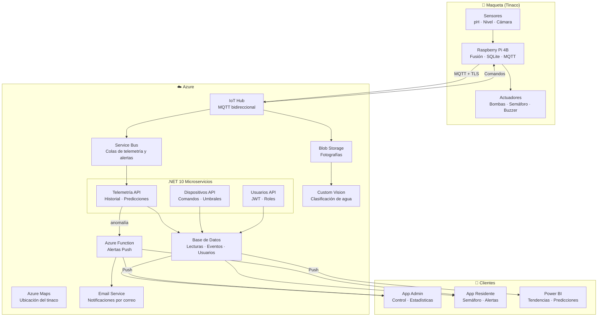

<p align="center">
  
  
  
  
  
</p>

<h1 align="center">🚰 Tinaco Inteligente</h1>

<p align="center">
  <strong>Monitoreo de Calidad de Agua mediante Visión Artificial, Purga Automática y Arquitectura de Microservicios en Azure</strong>
</p>

<p align="center">
  Proyecto Integrador — Ingeniería en Sistemas Computacionales — 9.° Cuatrimestre<br/>
  Universidad Politécnica de Aguascalientes · Septiembre – Diciembre 2026
</p>

---

## 👥 Equipo

| Integrante | Matrícula | Rol Principal |
|:---|:---:|:---|
| **Juan Jesus Rodriguez Arellano** | UP230253 | App Móvil · Arquitectura Cloud |
| **Omar Alejandro Dueñas Cervantes** | UP230254 | Backend .NET · Azure DevOps |
| **Marco Isai Martinez Moreno** | UP230533 | Sistemas Embebidos · Raspberry Pi |
| **Luis Fernando Flores Jáuregui** | UP230823 | Inteligencia de Negocios · Power BI |
| **Ismael Diaz de Leon Chiquito** | UP230585 | Hardware · Fusión de Sensores |

---

## 📋 Problema

Los tinacos domésticos rara vez se revisan. Acumulan sarro, algas y sedimentos sin que nadie lo note hasta que el agua sale turbia. Las variaciones de pH pasan totalmente desapercibidas.

**Solución:** Un sistema embebido que monitorea la calidad del agua en tiempo real, detecta contaminación por visión artificial + pH, purga automáticamente y notifica al usuario desde su celular.

---

## 🏗️ Arquitectura



---

## 🛠️ Stack Tecnológico

| Capa | Tecnología | Versión |
|:---|:---|:---:|
| **App Móvil** | React Native · Expo · TypeScript | SDK 57 |
| **Backend** | ASP.NET Core · Minimal APIs | .NET 10 |
| **Embebidos** | Python · SQLite · OpenCV | 3.11 |
| **Hardware** | Raspberry Pi 4B · ADS1115 · HC-SR04 · PH-4502C | — |
| **Nube** | Azure (IoT Hub · Service Bus · Custom Vision · Blob · App Service · Functions · Maps · Email) | — |
| **BI** | Power BI · Regresión Lineal | — |

---

## ☁️ Servicios de Azure

| Servicio | Función | Costo |
|:---|:---|:---:|
| **IoT Hub** | Conecta Raspberry Pi por MQTT | Gratuito |
| **Service Bus** | Cola de mensajes (cero pérdida) | Básico |
| **Custom Vision** | Clasifica fotos: limpia / algas / sarro / vacío | Gratuito |
| **Blob Storage** | Almacena fotos del tinaco y del celular | Gratuito |
| **App Service** | Aloja los 3 microservicios .NET 10 | Gratuito |
| **Functions** | Dispara notificaciones push ante alertas | Gratuito |
| **Azure Maps** | Ubicación geográfica del tinaco | Gratuito |
| **Email Service** | Envía correos de alerta al usuario | Gratuito |
| **Base de Datos** | Lecturas, eventos, usuarios, historial | Gratuito |

---

## 🧠 Fusión de Sensores

El sistema combina tres señales para decidir si purga o no:

| Detección Visual | pH | Nivel | Diagnóstico |
|:---|:---|:---|:---|
| Pared Limpia > 80% | 6.5 – 8.5 | 20% – 100% | 🟢 **Agua Óptima** |
| Algas > 65% | > 8.2 | Cualquiera | 🔴 **Purga Automática** |
| Sarro > 70% | > 8.0 | Bajo/Medio | 🟡 **Mantenimiento** |
| Dudosa < 55% | < 6.0 ó > 9.0 | Cualquiera | 🔴 **Riesgo Químico** |
| Tinaco Vacío > 85% | Sin lectura | ~0% | ⚪ **Confirmación Vaciado → Rellenado** |

---

## 👤 Roles de Usuario

<table>
<tr>
<th width="50%">🔑 Administrador</th>
<th width="50%">🏠 Residente</th>
</tr>
<tr>
<td>

- Dashboard de monitoreo en tiempo real
- Control manual de actuadores (purga, llenado, foto)
- Configuración de umbrales de pH y nivel
- Estadísticas de BI y predicciones
- Gestión de usuarios

</td>
<td>

- Semáforo de calidad del agua (solo lectura)
- Notificaciones push de alertas
- Historial de lecturas diarias
- Cámara del celular para inspección rápida
- **No puede** activar actuadores

</td>
</tr>
</table>

---

## 📂 Estructura del Proyecto

<details>
<summary><strong>Ver estructura completa</strong></summary>

```
tinaco-inteligente/
├── .github/                    # GitHub config
│   ├── ISSUE_TEMPLATE/         # Bug, feature, task templates
│   ├── workflows/              # CI/CD pipelines
│   ├── pull_request_template.md
│   ├── CODEOWNERS
│   └── dependabot.yml
│
├── docs/                       # Documentación
│   ├── architecture/           # Diagramas y flujos del sistema
│   ├── figma/                  # Specs de diseño UI/UX
│   ├── api/                    # Documentación de endpoints
│   └── hardware/               # BOM y diagramas de conexión
│
├── src/
│   ├── mobile/                 # React Native + Expo (TypeScript)
│   │   ├── screens/
│   │   │   ├── auth/           # Login
│   │   │   ├── admin/          # Dashboard, Controles, Umbrales, BI
│   │   │   └── user/           # EstadoAgua, Historial, Cámara
│   │   ├── components/         # CardLectura, SemaforoAgua, BtnPurga
│   │   ├── services/           # Axios calls a cada microservicio
│   │   ├── contexts/           # AuthContext (JWT + roles)
│   │   ├── hooks/              # useTelemetria, useAuth
│   │   ├── navigation/         # AdminTabs, UserTabs, AuthStack
│   │   └── types/              # TypeScript interfaces
│   │
│   ├── backend/                # .NET 10 Solution
│   │   ├── src/
│   │   │   ├── Telemetria.API/ # Historial, predicciones, fusión
│   │   │   ├── Dispositivos.API/ # Comandos IoT, umbrales, fotos
│   │   │   ├── Usuarios.API/   # Auth JWT, roles, CRUD usuarios
│   │   │   └── Shared/         # Modelos y utilidades comunes
│   │   ├── tests/              # Pruebas unitarias por servicio
│   │   └── functions/
│   │       └── AlertasPush/    # Azure Function de notificaciones
│   │
│   └── raspberry-pi/           # Python scripts
│       ├── sensors/            # pH, ultrasónico, cámara
│       ├── actuators/          # Relevadores, LED, buzzer
│       ├── database/           # SQLite offline
│       ├── cloud/              # MQTT + sync manager
│       └── fusion/             # Algoritmo de fusión de sensores
│
├── infra/                      # Azure Bicep IaC
│   ├── main.bicep
│   ├── modules/                # Un .bicep por servicio
│   └── parameters/             # dev.bicepparam, prod.bicepparam
│
├── Informacion/                # Docs de referencia del proyecto
├── .gitignore
├── .editorconfig
├── LICENSE
├── CONTRIBUTING.md
├── SECURITY.md
├── CODE_OF_CONDUCT.md
└── README.md
```

</details>

---

## 🚀 Cómo Ejecutar

<details>
<summary><strong>📱 App Móvil (Expo)</strong></summary>

```bash
cd src/mobile
npm install
npx expo start
```

> Escanea el QR con Expo Go o presiona `w` para abrir en navegador.

</details>

<details>
<summary><strong>⚙️ Backend (.NET 10)</strong></summary>

```bash
cd src/backend/src/Telemetria.API
dotnet run

cd src/backend/src/Dispositivos.API
dotnet run

cd src/backend/src/Usuarios.API
dotnet run
```

> Cada microservicio corre en un puerto distinto. Swagger disponible en la raíz.

</details>

<details>
<summary><strong>🍓 Raspberry Pi</strong></summary>

```bash
cd src/raspberry-pi
pip install -r requirements.txt
python main.py
```

> Requiere Raspberry Pi OS con GPIO habilitado e I2C activo.

</details>

<details>
<summary><strong>☁️ Azure Infra (Bicep)</strong></summary>

```bash
az bicep build --file infra/main.bicep
az deployment group validate -g rg-tinaco -f infra/main.bicep --parameters infra/parameters/dev.bicepparam
az deployment group what-if -g rg-tinaco -f infra/main.bicep --parameters infra/parameters/dev.bicepparam
```

> Nunca ejecutar `az deployment group create` sin aprobación del equipo.

</details>

---

## 🎨 Diseño (Figma)

Las especificaciones de diseño viven en [`docs/figma/`](docs/figma/):

| Página | Contenido |
|:---|:---|
| `01_DesignSystem` | Tokens, paleta semáforo, tipografía, espaciado |
| `02_Wireframes_Admin` | Dashboard, controles hardware, umbrales, BI |
| `03_Wireframes_User` | Semáforo, historial, cámara inspección |
| `04_Components` | CardLectura, BtnPurga, SemaforoAgua, ContenedorVisionAI |
| `05_FlowDiagrams` | Login → routing por rol → pantallas |
| `06_NamingConventions` | Capas Figma → componentes React Native |

---

## 📏 Reglas del Repositorio

| Regla | Detalle |
|:---|:---|
| **Ramas** | `main` protegida · trabajo en `feature/`, `fix/`, `docs/`, `infra/` |
| **Commits** | Conventional Commits: `feat:`, `fix:`, `docs:`, `infra:`, `test:` |
| **PRs** | Requieren 1 review + template obligatorio |
| **CI** | Lint frontend · Build backend · Lint Python |

---

## 📄 Licencia

Este proyecto es de uso académico bajo la licencia [MIT](LICENSE).

---

<p align="center">
  <strong>Universidad Politécnica de Aguascalientes</strong><br/>
  Ingeniería en Sistemas Computacionales · ISC09C<br/>
  Materias: Sistemas Embebidos | Inteligencia de Negocios | Programación Móvil
</p>
